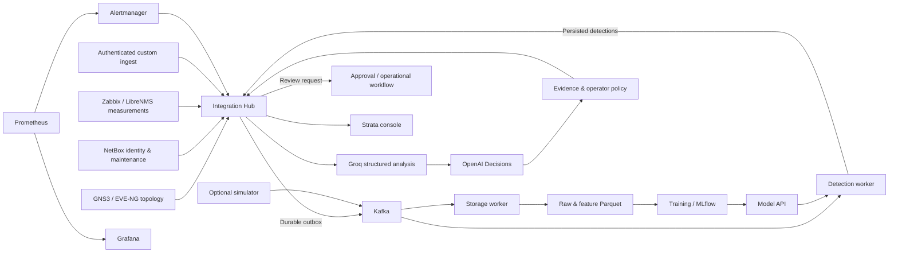

# Strata — network intelligence & operations

An English-language operations workspace for ISP NOCs, network providers, and infrastructure teams. Strata connects field monitoring, inventory, streaming telemetry, ML detection, and AI decision review in one evidence-based workflow.

The layered network logo represents infrastructure, telemetry, and decisions connected through a common operational view. The console uses a restrained carbon and steel palette, orbital halftone, rounded surfaces, responsive navigation, and accessible motion.

## What is implemented

- **Five field adapters:** NetBox, Zabbix, LibreNMS, GNS3 v2, and EVE-NG, with configurable mappings and shared device identities.
- **Validated telemetry:** source/event IDs, UTC timestamps, measurement ranges, optional labels, and explicit missing values.
- **Durable processing:** Kafka commits after successful storage/detection; invalid events are acknowledged in a dead-letter topic before committing their source offsets.
- **Persistent incidents:** consecutive confirmations, event deduplication, maintenance suppression, late-event rejection, recovery confirmation, and transition history.
- **Real operational monitoring:** collector freshness, ten platform probes, storage/detection heartbeats and counters, Kafka lag, dead-letter offsets, firing alerts, delivery retries, regional footprint, and daily AI usage.
- **Reviewable AI:** on-demand Groq structured analysis followed by OpenAI Decisions, allowed actions, confidence/evidence gates, evidence hashes, provider-stage auditing, persistent cooldown/quota, and idempotent review submission.
- **Practical operator UI:** searchable incidents/inventory, provider configuration, setup checklist, animated detail dialogs, reduced-motion support, operational snapshot exports, and decision audit exports.
- **Inspectable ML:** shared causal features, chronological holdout, train-only scaler fitting, historical model artifacts, MLflow evaluation, and measured-rule fallback.
- **Field engineering:** lab topology and an Ansible playbook for approved latency/loss experiments on Linux lab interfaces.

## Data flow



## Start on Windows

The full stack requires a running Docker Desktop engine and Compose v2 supporting `up --wait`. Python application dependencies run in containers.

```powershell
Copy-Item .env.example .env
.\start.ps1
.\status.ps1
```

The default demo mode starts 50 synthetic devices. `start.ps1` creates `.env` only when it is missing. Initial image builds download dependencies. Model API can run before a model is loaded; the predictor uses rules on measured fields until ML is available.

Wait for several storage batches, then train:

```powershell
.\train.ps1
```

Training reads up to 200 recent feature files through pagination and deduplicates event IDs. At least 100 complete observations are required. Random Forest needs labels and both classes in train/holdout; use `MODEL_NAME=isolation_forest` when those requirements are unmet. The script restarts Model API to load the selected model.

For the console and configured collectors without Docker:

```powershell
python -m venv venv
.\venv\Scripts\python.exe -m pip install -r requirements.txt
.\console.ps1
```

Open **http://127.0.0.1:8082/** and sign in with `INTEGRATION_API_TOKEN` from `.env`. Starting the console alone does not start its infrastructure dependencies.

## Connect field systems

Configure vendor URLs, credentials, project/lab IDs, item keys, interface mappings, and aliases in `.env` and `config/connectors.yml`. Enable the adapters for installations you can access.

```powershell
.\start.ps1 -Mode field -Orchestration
```

Field mode stops the Compose simulator. `-Orchestration` adds Airflow and its database. Enable the `telco_data_pipeline` DAG in Airflow; it processes scheduled hourly intervals with S3 pagination while preserving unlabeled data. Set `AIRFLOW_URL` for its health probe, using internal Compose DNS when the Hub runs in Docker.

See the [console and AI guide](docs/AI_CONSOLE.md), [ISP pilot guide](docs/ISP_PILOT.md), [integration reference](docs/INTEGRATIONS.md), and [field experiment guide](docs/FIELD_LAB.md).

## Service access

| Service | Host URL | Purpose / local access |
|---|---|---|
| Strata | http://localhost:8082/ | `INTEGRATION_API_TOKEN` |
| Operations API | http://localhost:8082/docs | Bearer token on data and mutation endpoints |
| Model API | http://localhost:8081/docs | `/ready` and `/model/info` expose model readiness |
| Grafana | http://localhost:3000 | admin / `GRAFANA_ADMIN_PASSWORD` |
| Prometheus | http://localhost:9090 | Metrics and alert rules |
| Alertmanager | http://localhost:9093 | Platform alert delivery |
| Storage worker | http://localhost:9101/metrics | Heartbeats and acknowledgement counters |
| Detection worker | http://localhost:9102/metrics | Heartbeats, counters, and rule fallbacks |
| MinIO console | http://localhost:9001 | `MINIO_ACCESS_KEY` / `MINIO_SECRET_KEY` |
| MLflow | http://localhost:5000 | Model experiments and artifacts |
| Optional Airflow | http://localhost:8080 | `AIRFLOW_ADMIN_USER` / `AIRFLOW_ADMIN_PASSWORD` |
| Kafka | 127.0.0.1:29092 | Host-accessible broker |

Host bindings use loopback. Example credentials are for a local lab; replace them for your environment. Use a URL-safe Hub token because Alertmanager inserts it into its YAML configuration at startup.

```powershell
docker compose logs -f consumer predictor integration-hub
.\stop.ps1
```

Stopping preserves volumes. Scripts manage this Compose project and do not terminate arbitrary Python processes by port.

## API

All operational data and mutations require Bearer authentication. `/health`, `/metrics`, and the static console are available for local probes and initial access.

| Method | Endpoint | Function |
|---|---|---|
| GET | /console/overview | Console snapshot and operational metadata |
| GET | /connectors, /inventory, /topology | Source snapshots |
| POST | /ingest/metrics | Validate and durably queue 1–500 telemetry events |
| POST | /detections | Persist observations and incident lifecycle |
| GET | /incidents, /incidents/{id}/history | Current evidence and transition history |
| POST | /alerts/alertmanager | Receive firing/resolved platform alerts |
| GET | /ai/status, /ai/decisions | Provider configuration and latest audits |
| POST | /incidents/{id}/analyze | On-demand AI analysis |
| POST | /ai/decisions/{id}/request-review | Recheck evidence and queue operator review |

Incidents default to three anomalous confirmations and three normal confirmations for recovery. Incomplete telemetry or a changed detection method does not silently clear an open incident. Alertmanager already applies Prometheus `for` durations. Model API rejects missing required features with 422; the predictor continues with rules on available measurements.

## Verify

```powershell
.\venv\Scripts\python.exe -m pip install -r requirements-dev.txt
.\venv\Scripts\python.exe -m unittest discover -s tests -v
```

Tests use vendor fixtures, temporary SQLite databases, actual scikit-learn inference, and mocked provider contracts. See [validation evidence](docs/VALIDATION.md) for tested behavior and live deployment limits.

## Deployment scope

For GitHub-triggered Vercel builds and a backend that stays online when your laptop is off, follow [the GitHub remote deployment guide](docs/GITHUB_REMOTE_DEPLOYMENT.md). Vercel Root Directory is `deploy/vercel` and its build command is `node build.mjs`; enable source access outside that directory. For the standalone CLI alternative, see [the online deployment guide](docs/ONLINE_DEPLOYMENT.md) and package with `node scripts/package_vercel.mjs`. `scripts/prepare_online.py` creates separate generated credentials without changing the local `.env`.

This is a single-broker, single-Hub lab/pilot stack. Delivery is at least once; receivers need idempotency. SQLite retains outbox and dedup records, so establish retention before high-volume ingestion. In-memory feature history warms up after restart. Training and incidents deduplicate event IDs; replay can duplicate stored/prediction records.

AI and incident workflows request review; external receivers own authorization, runbooks, prechecks, rollback, and execution verification. The current shared Hub token has no operator identity or RBAC. Multi-tenant isolation, high availability, contractual SLA calculation, and cross-source root-cause correlation remain production roadmap items. Isolation Forest scores are not calibrated anomaly probabilities.

Legacy Terraform, Kubernetes, nested Compose, and `ansible/setup.yml` examples remain separate from the root Compose runtime. Do not start conflicting deployment managers on the same service ports. New Compose volumes do not automatically import old datasets; export/import data you intend to retain.

Project by Robertino Gladden. Strata branding is a project identity, without trademark or domain-availability claims.
