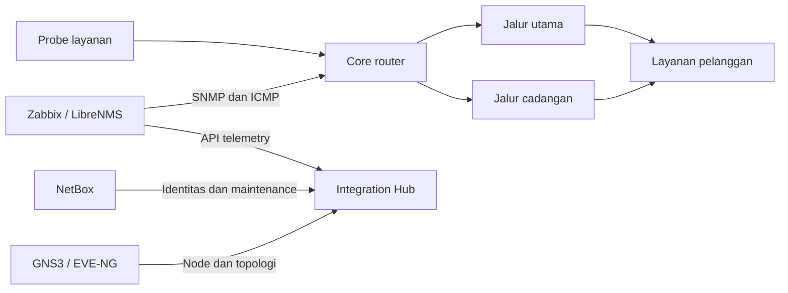

# Lab engineering yang menghasilkan gangguan nyata

Bangun dua router virtual dengan jalur utama dan cadangan di GNS3 atau EVE-NG. FRRouting/Linux dapat dipakai tanpa menggantungkan seluruh demonstrasi pada simulasi JSON. Tambahkan endpoint layanan pada sisi pelanggan dan probe pada sisi core. Sambungkan management network ke Zabbix/LibreNMS, lalu daftarkan router dan site di NetBox.



Tahap pertama: buktikan traffic sungguhan lewat jalur utama, ukur RTT/loss dan CPU, lalu pastikan nama/IP terhubung ke inventaris. Aktifkan semua konektor yang digunakan melalui `.env`; ambil snapshot `/inventory` dan `/topology` sebagai bukti pemetaan. `start.ps1 -Mode field` menghentikan simulator Compose agar data lab yang ditinjau jelas asalnya.

| Skenario | Masalah engineering | Bukti keberhasilan |
|---|---|---|
| Tambah delay/loss pada jalur utama | Service degradation dan pemilihan jalur cadangan | RTT/loss aktual berubah, insiden terbuka setelah konfirmasi, recovery baru terjadi setelah pengukuran kembali normal |
| Putus management connection ke Zabbix | Collector outage dibanding gangguan jaringan | ConnectorDown muncul; inventory terakhir tetap tersedia; tidak ada nilai sehat buatan |
| Hentikan MinIO sementara | Reliability pipeline | Consumer belum commit batch gagal; setelah restart data direplay dan event ID bisa didedup |
| Hentikan Integration Hub | Ketergantungan pada pencatatan insiden | Predictor gagal commit lalu replay; event sama tidak menggandakan jumlah konfirmasi |
| Matikan salah satu sumber telemetry | Evidence tidak lengkap | Insiden aktif tidak dipulihkan oleh observasi yang kehilangan metrik sebelumnya |
| Tandai router maintenance di NetBox | Koordinasi operasi dan automation | Insiden menjadi suppressed dan tidak mengantrekan permintaan workflow |
| Ganggu endpoint workflow | Retry dan efek samping | Permintaan tetap pending dan dikirim ulang dengan Idempotency-Key yang sama |

## Injeksi gangguan Linux yang terkendali

Playbook `ansible/lab_impairment.yml` menjalankan `tc netem` pada interface yang dipilih. Gunakan host Linux khusus lab dengan interface data yang terpisah dari SSH/management. Playbook mengharuskan flag `aiops_lab=true` di inventory dan menolak mengganti qdisc lain yang sudah terpasang. Tool `tc` harus tersedia pada host.

Contoh inventory:

```ini
[aiops_lab]
primary-link ansible_host=192.168.56.110 ansible_user=lab aiops_lab=true impairment_interface=eth1
```

Jalankan dari host yang memiliki Ansible:

```bash
ansible-playbook -i lab.ini ansible/lab_impairment.yml -e impairment_state=present -e delay_ms=250 -e loss_pct=12
ansible-playbook -i lab.ini ansible/lab_impairment.yml -e impairment_state=absent
```

Gangguan berlangsung sampai perintah `absent` dijalankan. Ambil pengukuran sebelum, selama, dan sesudahnya; bandingkan dengan insiden serta grafana. Playbook ini tersedia sebagai alat eksperimen dan tidak dijalankan oleh predictor. Pengujian repository tidak menjalankan Ansible di router.

## Bukti yang perlu disimpan

Simpan ID event, topic/partition/offset pada replay, snapshot inventory/topologi, trace insiden, delivery workflow, dan hasil probe. Nilai model yang baik di data sintetis belum membuktikan kinerja pada jaringan nyata. Uji dataset domain/router yang sama sebelum membuat keputusan perubahan konfigurasi dari model.

Peningkatan berikutnya yang membutuhkan lingkungan lapangan: runbook vendor yang benar dengan precheck/rollback, model per service/domain, incident correlation lintas sumber, serta penyimpanan terdistribusi untuk banyak instance Hub. Fondasi sekarang memisahkan batas tersebut secara eksplisit sehingga evidence dapat dikumpulkan dan kegagalan bisa direproduksi.
