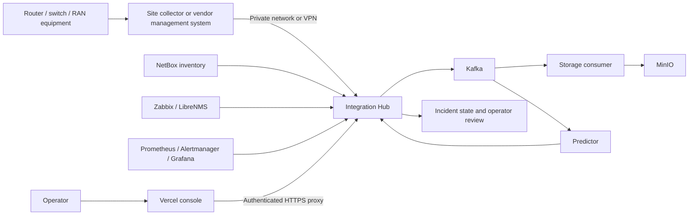

# Full-stack cloud pilot with field telemetry

The selected target is Strata processing actual equipment telemetry with Kafka, MinIO, continuous workers and operational monitoring retained. A reduced serverless backend is not the selected direction. GitHub stores source; Vercel hosts the console; a continuously running cloud VM or container host runs the backend. No backend code was replaced by the earlier hosting proposals.

The private equipment/collector connection and authenticated browser connection are different ingress paths. The current public gateway rejects ingest endpoints; field ingestion must use the private path. Do not publish device management ports, Kafka, MinIO or internal dashboards to make a collector reachable.

## Free compute candidate

[Oracle Cloud Always Free](https://docs.oracle.com/en-us/iaas/Content/FreeTier/freetier_topic-Always_Free_Resources.htm) is a candidate for a VM-based pilot. As checked on 2026-10-11, its documentation lists Ampere A1 allowances equivalent to **2 OCPUs and 12 GB RAM**, plus **200 GB combined boot/block storage**. Capacity can be unavailable, and idle instances may be reclaimed. Confirm the current account/region quota rather than assuming eligibility. Standard [signup](https://docs.oracle.com/en-us/iaas/Content/GSG/Tasks/signingup_topic-Sign_Up_for_Free_Oracle_Cloud_Promotion.htm) includes payment-card verification; do not select a paid upgrade as part of this zero-budget route.

This is a hosting candidate, not a tested deployment or a guarantee that every service fits. A1 uses ARM: verify manifests for every exact image tag and build Python dependencies on the target architecture. The current Compose uses older Confluent Kafka/ZooKeeper images; changing architecture or migrating Kafka storage requires separate validation. Do not add amd64 emulation as a presumed production solution. Benchmark memory, CPU, disk and retention with the actual pilot load before deciding which optional services fit.

The existing online configuration assumes a Cloudflare-managed hostname and Access service authentication. Since there is no domain/account deployment yet, the HTTPS hostname and authentication route remain unresolved. A free VM does not automatically configure the Vercel proxy. See [the online configuration](ONLINE_DEPLOYMENT.md) for the existing boundary; any alternative must implement equivalent origin/operator protection before exposing field data.

## What exists and what still requires equipment integration

| Area | Current project | Work still required |
|---|---|---|
| Event and storage pipeline | Kafka, storage consumer, MinIO, predictor and local persistent incident state | Live container startup, persistence/recovery validation and resource measurements |
| Platform monitoring | Prometheus, Grafana, Alertmanager and Kafka exporter | Field-scale sizing and operating procedures |
| NOC integrations | NetBox, Zabbix and LibreNMS API adapters | Reachable installations, credentials, device identity and actual vendor metric mappings |
| Virtual network lab | GNS3 v2 and EVE-NG adapters | Independently hosted labs and traffic/probes; these are not physical equipment |
| RAN / drive test | Generic authenticated telemetry ingestion | Vendor OSS/EMS or equipment-export adapters; dedicated RSRP/RSRQ/SINR, cell/PCI, GPS, handover and session contracts/views |
| AI and workflow | On-demand analysis and operator-review requests | Provider access and usage budget; authorized device execution/rollback is not implemented |

Kafka and MinIO are backend software, not radio equipment or measurement sources. Actual RAN observations require access to an authorized OSS/EMS, export files or an active measuring device. A powered-off site collector cannot produce new samples even when the cloud backend remains online. The developer laptop can be off when those components run independently.

## Deployment sequence

1. Upload the current source using [git remote without clone](GIT_REMOTE_QUICKSTART.md).
2. Obtain an eligible cloud VM and verify its quota and architecture. No VM/account has been provisioned by this repository.
3. Validate exact container images and builds, persistent volumes, restart behavior and resource use. The core Compose pipeline remains the starting point; optional training/orchestration has separate resource needs.
4. Resolve backend HTTPS/operator authentication and private field connectivity, then deploy the protected backend and configure Vercel's server variables.
5. Connect one actual source, validate timestamps/units/device identity and disable the simulator. Demonstrate incident detection and recovery using actual traffic or measurements before adding more sources.

The current Kafka topic setup has replication factor 1 and the Hub uses SQLite. This can exercise real equipment in a single-host pilot, but it does not provide a redundant production NOC. Free-tier capacity and availability are not a commitment to customer production uptime. A licensed or proprietary vendor tool remains subject to obtaining its actual software/data access; installing the Strata backend does not supply it.
