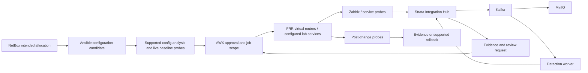

# Strata native software reference

Strata pairs an owned browser operations simulator with optional native-software lab definitions and clearly scoped telecom roles. It is a portfolio environment; physical RF and protocol equivalence are not claimed.

The public application opens the Digital Twin lab; see [the simulator guide](STRATA_TWIN.md). This internal catalog retains software roles and optional native lab designs, and is excluded from public Vercel assets. Live Operations still requires its separate backend.

The catalog contains **50 components across 12 layers**. It includes core choices and optional alternatives, not a claim that every listed tool is deployed or used by every telecom operator. Walkthroughs inspect design stages; they do not execute external jobs or synthesize live service-health claims.

## Allocation ownership

- **IP / VLAN / VRF / ASN plan — NetBox:** NetBox records intended allocations. Automation must validate uniqueness and reserve resources before rendering a device configuration.
- **BGP / OSPF paths and failover — FRRouting:** Routing daemons calculate paths from protocol state and policy. Ansible applies the intended router settings; NetBox remains the design record.
- **Bandwidth, queues and loss experiments — Linux tc / netem:** Linux tc enforces lab egress queue/rate policy. netem reproduces delay and loss. These controls do not allocate physical radio spectrum.
- **Dynamic client IP leases — ISC Kea:** Kea assigns leases from configured address pools and reservations. IPAM and DHCP must use a shared, validated plan.
- **UE sessions and user-plane selection — Open5GS:** Core functions manage subscriber/session context; SMF configures session forwarding through UPF. A PDU session is separate from radio resource allocation.
- **Radio resources / PRBs / scheduling — srsRAN Project:** The RAN scheduler owns radio-resource behavior in a compatible RAN setup. UERANSIM is used here for protocol simulation; RF measurements remain outside its evidence scope.

## Recommended lab composition

The optional [native lab definitions](EXECUTABLE_LAB.md) use Compose/FRRouting, a dedicated Ansible controller, staged NetBox and Kafka/MinIO/Strata/Prometheus/Grafana profiles, plus a separate Open5GS/UERANSIM track. They have not run on this laptop. Containerlab, Zabbix and AWX are reference alternatives/extensions, not installed dependencies. Start with [Strata Twin](STRATA_TWIN.md) for the current Vercel-native portfolio.

LibreNMS can complement or replace the initial NMS. GNS3 and EVE-NG are alternative lab engines. Nornir/NAPALM/Netmiko provide alternative automation paths; choose supported device drivers rather than requiring all libraries at once. OpenDaylight, srsRAN and OpenAirInterface belong to further SDN/RAN tracks. Supporting services such as Redis/MongoDB depend on the chosen application's installation and should be recorded when those services are actually deployed.

The mobile-core track exercises subscriber registration, session establishment and user-plane forwarding. UERANSIM's simulated radio link does not supply physical RSRP/RSRQ/SINR or validated RF handover performance. Radio scheduling requires a compatible RAN implementation/test environment. Do not infer core traffic capacity from a radio label.

## Proposed operational loop

This loop is the target architecture. The existing Hub provides durable telemetry and review requests, not device execution. AWX launching, IPAM writes, provisioning templates, configuration backups and supported rollback remain implementation work. The existing Ansible artifact handles only bounded Linux link impairment.

## Illustrative site allocation

| Site | Management prefix / VLAN | Service prefix / VLAN | Private ASN |
|---|---|---|---|
| JKT-001 | 10.80.1.0/24 / 101 | 10.81.1.0/24 / 201 | 65101 |
| BDG-001 | 10.80.2.0/24 / 102 | 10.81.2.0/24 / 202 | 65102 |
| SBY-001 | 10.80.3.0/24 / 103 | 10.81.3.0/24 / 203 | 65103 |

These are checked design samples, not allocations read from or written to a running NetBox. Current validation requires distinct VLANs within this single lab scope; production VLAN reuse has a different scope model.

## Catalog and official references

Repository labels describe implementation scope, not running service health. Compose-defined applications still need startup validation; adapter-implemented applications need independent installations; planned/optional applications have no native integration yet.

### Inventory & IPAM

What should exist at each site?

| Software | Role / interface | Repository scope |
|---|---|---|
| [NetBox](https://netboxlabs.com/docs/netbox/) | Source of truth for sites, devices, circuits, prefixes, IPs, VLANs, VRFs and ASNs. REST API / planned IPAM writes | **Adapter implemented** — Read adapter and native inventory-profile/ORM seed definitions exist. Actual NetBox startup/seeding and general allocation write automation are not live-validated. |

### Transport & routing

Where does traffic travel?

| Software | Role / interface | Repository scope |
|---|---|---|
| [FRRouting](https://frrouting.org/) | Run actual BGP, OSPF and BFD control planes on virtual Linux routers. vtysh / routing protocols | **Lab artifact available** — Native five-router configurations and isolated Compose topology are defined. Docker execution and BGP/traffic validation are pending. |
| [Open vSwitch](https://docs.openvswitch.org/en/latest/) | Virtual switching, VLAN separation and OpenFlow-controlled forwarding. OVSDB / OpenFlow | **Optional extension** — An alternative forwarding extension; not required for every FRR lab. |
| [Linux tc / netem](https://git.kernel.org/pub/scm/network/iproute2/iproute2.git/tree/man/man8/tc.8) | Traffic shaping, queue policies and reproducible delay/loss on lab interfaces. Ansible command tasks / Linux qdisc | **Lab artifact available** — Allowlisted owned netem delay/loss changes are defined for dedicated virtual routers. No container or actual qdisc has been executed on this laptop. |
| [OpenDaylight](https://docs.opendaylight.org/en/latest/) | Explore controller-driven SDN and model-based device integration. RESTCONF / NETCONF / OpenFlow modules | **Optional extension** — Optional SDN track; protocol/module support must match the selected release and devices. |

### Access services

How do clients get addresses and access?

| Software | Role / interface | Repository scope |
|---|---|---|
| [ISC Kea](https://kea.readthedocs.io/en/latest/arm/intro.html) | DHCPv4/v6 leases, reservations and IPv6 prefix delegation for virtual clients. DHCP / control API | **Planned lab component** — Consumes address policy; does not decide the whole site's routing design. |
| [PowerDNS](https://docs.powerdns.com/authoritative/) | Authoritative DNS records for sites and customer service endpoints. DNS / HTTP API | **Optional extension** — Authoritative and recursive DNS are separate services; choose the required role. |
| [FreeRADIUS](https://www.freeradius.org/) | Authentication, authorization and accounting for network access experiments. RADIUS | **Optional extension** — Access policy is separate from IPAM and radio scheduling. |

### Configuration automation

Who validates and applies a change?

| Software | Role / interface | Repository scope |
|---|---|---|
| [Ansible](https://docs.ansible.com/projects/ansible/latest/network/getting_started/) | Execute repeatable device/Linux configuration and verification playbooks. SSH / vendor network modules | **Lab artifact available** — Native approved lab tasks and controller review/verification code exist. Live Ansible execution is pending; general vendor provisioning remains external. |
| [AWX](https://docs.ansible.com/projects/awx/en/24.6.1/userguide/workflow_templates.html) | Run Ansible jobs with inventory, credentials, workflow approvals and job history. Job/workflow templates / REST API | **Planned lab component** — Strata currently sends generic review webhooks; an AWX receiver/launcher is still needed. |
| [Nornir](https://nornir.readthedocs.io/en/latest/) | Python inventory and concurrent task dispatch for network automation. Python task plugins | **Optional extension** — Alternative automation implementation; not another approval engine. |
| [NAPALM](https://napalm.readthedocs.io/en/latest/) | Unified getters and configuration operations for supported network OS drivers. Python driver API | **Optional extension** — Candidate/diff/commit/rollback capabilities differ by vendor driver; FRR support must be checked. |
| [Netmiko](https://github.com/ktbyers/netmiko) | Interact with supported network-device CLIs over SSH. Python SSH / device CLI | **Optional extension** — CLI transport alone does not provide transaction safety or rollback. |
| [Batfish](https://github.com/batfish/batfish) | Analyze supported configuration snapshots for reachability and policy before changes. Snapshot files / pybatfish | **Planned lab component** — Offline model analysis complements live probes; verify support for the selected configuration syntax. |
| [Oxidized](https://github.com/ytti/oxidized) | Capture device configuration versions and detect configuration drift. Device models / Git / REST API | **Planned lab component** — Backups help build a rollback plan; they do not prove rollback execution succeeded. |

### NOC observability

How is failure detected and explained?

| Software | Role / interface | Repository scope |
|---|---|---|
| [Zabbix](https://www.zabbix.com/documentation/current/en/manual) | Poll device/service metrics and evaluate monitoring triggers. SNMP/agent collection upstream / JSON-RPC API | **Adapter implemented** — External installation required; Strata reads configured item keys and source timestamps. |
| [LibreNMS](https://docs.librenms.org/) | Network discovery, interface/sensor polling and network monitoring. SNMP collection upstream / REST API | **Adapter implemented** — Alternative or complementary NMS; avoid double counting shared interface measurements. |
| [Prometheus](https://prometheus.io/docs/introduction/overview/) | Scrape platform/exporter time series and evaluate alert rules. HTTP scrape / PromQL | **Compose defined** — Compose configuration exists; live scrapes require running services. |
| [Grafana](https://grafana.com/docs/grafana/latest/) | Visualize worker, connector, Kafka and operational metrics. Prometheus data source / dashboards | **Compose defined** — Dashboard provisioning exists; displayed values depend on actual measurements. |
| [Alertmanager](https://prometheus.io/docs/alerting/latest/alertmanager/) | Group and route Prometheus firing/resolved notifications to incident handling. Webhook / alert routing | **Compose defined** — Existing receiver records platform incidents; notification does not itself change a router. |
| [Grafana Loki](https://grafana.com/docs/loki/latest/) | Centralize service logs for incident investigation. Log push API / LogQL | **Optional extension** — Log shipping and data-source provisioning are not configured yet. |
| [OpenTelemetry](https://opentelemetry.io/docs/) | Instrument application traces, metrics and logs across services. OTLP / SDK / Collector | **Optional extension** — Application telemetry complements device SNMP and routing measurements. |
| [chrony](https://chrony-project.org/documentation.html) | Keep Linux lab hosts synchronized so evidence and change timelines can be compared. NTP / chronyc | **Planned lab component** — Clock synchronization and timestamp validation must both be checked. |

### Events, storage & models

How is evidence processed and retained?

| Software | Role / interface | Repository scope |
|---|---|---|
| [Apache Kafka](https://kafka.apache.org/documentation/) | Durable event streams for telemetry, detections and dead-letter records. Kafka producer/consumer protocol | **Compose defined** — Current lab uses one broker and replication factor 1. |
| [Kafka Connect](https://kafka.apache.org/documentation/#connect) | Run connector-based imports/exports around Kafka. Connector plugins / REST API | **Optional extension** — Choose connectors for actual sources; current Python adapters do not require Connect. |
| [Schema Registry](https://docs.confluent.io/platform/current/schema-registry/index.html) | Manage event schema versions and compatibility policies. REST API / serializers | **Optional extension** — Current JSON/Pydantic contracts work without a registry; serializer migration is separate work. |
| [MinIO](https://github.com/minio/minio) | S3-compatible object storage for raw/processed Parquet and model artifacts. S3 API | **Compose defined** — Pinned community source build replaces an unavailable binary image tag. Upstream community repository is archived; image compilation and live storage remain unverified. |
| [Apache Airflow](https://airflow.apache.org/docs/) | Schedule data-processing DAGs with task dependency tracking. DAGs / scheduler / REST API | **Compose defined** — Optional orchestration profile; it is not the routing controller or radio scheduler. |
| [MLflow](https://mlflow.org/docs/latest/index.html) | Track training runs, evaluation metadata and model artifacts. Tracking API / artifact store | **Compose defined** — Model evaluations require a representative dataset; storage is not proof of detection quality. |
| [PostgreSQL](https://www.postgresql.org/docs/current/intro-whatis.html) | Relational state for applications such as Airflow and future NetBox/AWX services. SQL | **Compose defined** — Current PostgreSQL service belongs to Airflow; Strata incident/outbox state still uses SQLite. |

### Virtual sites & diagnostics

How is network behavior reproduced?

| Software | Role / interface | Repository scope |
|---|---|---|
| [Containerlab](https://containerlab.dev/manual/kinds/linux/) | Define repeatable virtual-router nodes and point-to-point links. Topology YAML / Linux containers | **Planned lab component** — Recommended transport-lab engine; a topology has not been deployed yet. |
| [GNS3](https://docs.gns3.com/) | Build virtual network topologies and connect appliances/probes. GNS3 v2 REST API | **Adapter implemented** — Existing adapter reads nodes/links; it does not deploy licensed vendor images. |
| [EVE-NG](https://www.eve-ng.net/index.php/documentation/) | Alternative virtual network lab with multi-appliance topologies. Lab API | **Adapter implemented** — External installation and version compatibility checks are required. |
| [iperf3](https://software.es.net/iperf/) | Generate real lab traffic and measure end-to-end throughput. Client/server traffic / JSON output | **Planned lab component** — Needs active endpoints; a link label is not a throughput measurement. |
| [Wireshark / tshark](https://www.wireshark.org/docs/) | Inspect packet captures to explain protocol and connectivity failures. PCAP / tshark CLI | **Optional extension** — Capture only the lab interfaces and retain evidence with scenario IDs. |

### Mobile core & RAN

How are UE sessions and radio functions represented?

| Software | Role / interface | Repository scope |
|---|---|---|
| [Open5GS](https://open5gs.org/open5gs/docs/) | Run an open-source EPC/5G core with subscriber, session and user-plane functions. 3GPP core interfaces / metrics / configuration | **Lab artifact available** — Pinned source-build and native YAML override/session profile definitions exist. Image compilation, slice compatibility and actual PDU traffic validation are pending; no physical RF is modeled. |
| [UERANSIM](https://github.com/aligungr/UERANSIM) | Simulate UE/gNB protocol behavior against a 5G core for registration and PDU-session tests. NGAP / NAS / GTP-U / simulated radio link | **Lab artifact available** — Native gNB/UE configurations and source-build profile use public lab fixtures. Real registration/PDU sessions have not run on this laptop. |
| [srsRAN Project](https://docs.srsran.com/projects/project/en/latest/) | Explore actual software RAN CU/DU functions in a dedicated RAN lab. 3GPP/O-RAN interfaces / RAN configuration | **Optional extension** — Radio/PHY testing depends on the selected supported test setup; not bundled into Strata. |
| [OpenAirInterface](https://openairinterface.org/) | Alternative software RAN/core research and integration track. 3GPP/O-RAN interfaces | **Optional extension** — Choose a documented compatible deployment; not a second mandatory RAN stack. |

### Identity & secrets

Who may access services and credentials?

| Software | Role / interface | Repository scope |
|---|---|---|
| [Keycloak](https://www.keycloak.org/documentation) | Operator identity, OIDC login and role-based application access. OIDC / OAuth2 / SAML | **Planned lab component** — Current shared Hub token is not a Keycloak or RBAC integration. |
| [OpenBao](https://openbao.org/docs/) | Manage service/device secrets and access policies. Secrets API | **Optional extension** — A secret store still needs workload authentication and application integration. |

### Change workflow & tickets

How is a change approved and tracked?

| Software | Role / interface | Repository scope |
|---|---|---|
| [n8n](https://docs.n8n.io/) | Connect incident intake, operator review and operational notifications. Webhooks / workflow nodes | **Optional extension** — A compatible idempotent receiver must be built; self-hosting terms are separate from software functionality. |
| [Zammad](https://docs.zammad.org/en/latest/) | Track incident ownership and change/ticket history. Ticket REST API | **Optional extension** — Ticket synchronization is planned; opening a ticket does not execute a network change. |

### Infrastructure & delivery

How is the lab deployed consistently?

| Software | Role / interface | Repository scope |
|---|---|---|
| [Docker Compose](https://docs.docker.com/compose/) | Run the current persistent backend services and isolated container networks. Compose YAML / Docker Engine | **Compose defined** — A running Docker Engine is required; no live engine is available in this workspace. |
| [Kubernetes](https://kubernetes.io/docs/concepts/overview/) | Study declarative service orchestration and deployment lifecycle at a later stage. Kubernetes API / manifests | **Optional extension** — Legacy examples are separate from the root Compose runtime; running Kubernetes does not imply HA. |
| [Terraform](https://developer.hashicorp.com/terraform/docs) | Define infrastructure resources reproducibly when a cloud lab is available. Providers / infrastructure state | **Optional extension** — Legacy examples are not a verified free-tier deployment; provider resources may incur costs. |
| [GitHub Actions](https://docs.github.com/en/actions) | Validate configuration candidates and produce repeatable build/evidence artifacts. Repository workflow YAML | **Planned lab component** — No automated router deployment pipeline is configured; Git push alone does not start the backend. |

### Operations & AI

How is evidence turned into a next step?

| Software | Role / interface | Repository scope |
|---|---|---|
| [Strata](https://github.com/RobertinoGladden/aiops-telco) | Unify inventory context, incidents, service evidence and operator decision review. Authenticated HTTP API / operations console | **Implemented in Strata** — Current workflows request review; device configuration execution and rollback are external/planned. |
| [Groq](https://console.groq.com/docs/overview) | On-demand structured interpretation of saved incident evidence. Provider API | **Provider integration** — Optional provider credentials and usage allowance are required; AI does not own IP/routing allocation. |
| [OpenAI Decisions](https://developers.openai.com/api/docs/guides/decisions) | Select typed next-step recommendations for operator policy review. Provider API / decision audit | **Provider integration** — Recommendations cannot directly execute arbitrary device commands. |

## Engineering scenarios

### Bring a new site online

Expected acceptance: A reserved allocation matches the rendered configuration, BGP sessions establish, and an end-to-end probe passes.

1. **Reserve the intended site resources** (NetBox). Evidence: Site ID, unique prefixes/VLANs/ASN and reservation record.
2. **Render a bounded configuration candidate** (Ansible). Evidence: Candidate diff and allowlisted target inventory.
3. **Validate reachability before the change** (Batfish). Evidence: Supported snapshot analysis and baseline live probe results.
4. **Approve and launch the configuration job** (AWX, Ansible). Evidence: Job ID, approver and idempotency key.
5. **Establish routing and client services** (FRRouting, ISC Kea). Evidence: BGP neighbor state, selected routes and DHCP lease.
6. **Verify service traffic and record evidence** (iperf3, Zabbix, Apache Kafka, MinIO). Evidence: Timestamped probe output, telemetry offsets and stored artifact.

### Recover from an impaired backhaul

Expected acceptance: Measured service performance returns after a reviewed path change; otherwise the lab restores its baseline.

1. **Apply the approved lab impairment** (Linux tc / netem, Ansible). Evidence: Selected data interface and before/after qdisc output.
2. **Detect measured loss and latency** (Zabbix, Prometheus, Alertmanager). Evidence: Fresh source measurements and firing alert timestamps.
3. **Persist the incident and its context** (Strata, Apache Kafka, MinIO, NetBox). Evidence: Incident version, source event IDs and topology context.
4. **Review the proposed next step** (Groq, OpenAI Decisions, Strata). Evidence: Optional AI audit or deterministic runbook review; maintenance and evidence checks.
5. **Execute a bounded lab runbook** (AWX, Ansible, FRRouting). Evidence: Config diff, saved baseline, job result and selected backup route.
6. **Verify recovery or roll back** (iperf3, Zabbix, Grafana). Evidence: Post-change traffic measurements; restored baseline when verification fails.

### Explain and recover configuration drift

Expected acceptance: The changed configuration is traced to a job/actor and the intended reachability is restored or the change is rejected.

1. **Compare captured and intended state** (Oxidized, NetBox). Evidence: Configuration revision, diff and intended site policy.
2. **Reproduce the policy violation** (Batfish, iperf3). Evidence: Snapshot query and a failed lab endpoint probe.
3. **Open a reviewed change record** (Strata, Zammad). Evidence: Incident/change correlation and named reviewer.
4. **Apply the supported restoration runbook** (AWX, Ansible). Evidence: Baseline artifact, target scope and execution result.
5. **Confirm the restored network state** (FRRouting, Zabbix, Oxidized). Evidence: Routes, fresh measurements and new configuration revision.

### Investigate a failed 5G PDU session

Expected acceptance: UE registration/session behavior and user-plane reachability are explained with protocol evidence, without claiming RF coverage validation.

1. **Define the virtual subscriber and core profile** (Open5GS, NetBox). Evidence: Lab-only subscriber, PLMN, DNN and address-pool plan.
2. **Attempt registration and session establishment** (UERANSIM, Open5GS). Evidence: UE/gNB logs and registration/PDU-session result.
3. **Inspect core metrics and packet evidence** (Prometheus, Wireshark / tshark, Grafana). Evidence: NGAP/NAS/GTP-U capture context and timestamped core observations.
4. **Correlate the failure with the intended profile** (Strata, Apache Kafka, MinIO). Evidence: Future mobile adapter event contract and saved protocol artifacts.
5. **Apply and verify a reviewed lab correction** (AWX, Ansible, iperf3). Evidence: Supported core-config diff, restarted test session and user-plane traffic probe.

## Run and publish

- Validate the catalog: `python scripts/check_portfolio.py`.
- Regenerate this guide after editing the catalog: `python scripts/check_portfolio.py --write-doc`.
- Build the static portfolio: `node deploy/vercel/build.mjs`; publish through the [GitHub/Vercel guide](GITHUB_REMOTE_DEPLOYMENT.md).
- Open `/#twin` for executable modeled scenarios; use the existing full-stack startup instructions to demonstrate actual Kafka/MinIO processing.
- Capture a real lab run separately: save configuration diffs, job/probe output, event IDs, Kafka offsets, stored artifacts and recovery evidence. Present those as recorded evidence rather than always-on backend health.

No vendor appliances, Docker services, AWX workflows or mobile-core sessions were launched while building this catalog. Current live-test limits are in [validation evidence](VALIDATION.md).
