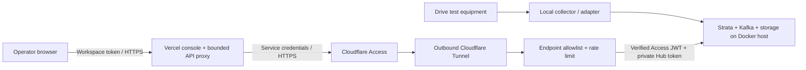

# Strata online pilot: Vercel console, private collector host

Use Vercel for the web console and its short-lived API proxy. Keep the existing Kafka broker, collectors, predictor, MinIO, SQLite and monitoring services on a continuously running Docker host. Vercel supports FastAPI request handlers, but moving this entire application there would not preserve its long-running collection threads, Kafka services or local durable state. A frontend deployment alone has no measurements to display.

For early testing, the Docker host can be your laptop: no VPS is required. It must remain powered on, connected and running Docker. A named Cloudflare Tunnel and a Cloudflare Access application protect its HTTPS endpoint. This configuration requires a domain managed through Cloudflare for the backend hostname. Vercel supplies a `vercel.app` frontend URL. A bare, unprotected temporary tunnel is not part of this configuration.



## 1. Prepare the backend without changing the local lab

From the project root, using the existing Windows virtual environment:

```powershell
.\venv\Scripts\python.exe -m pip install -r requirements.txt
.\venv\Scripts\python.exe scripts/prepare_online.py
```

This creates `.env.online` with generated Hub, operator, MinIO and administrator credentials; it does not overwrite `.env`. Keep this file private. The operator token and Hub token are different: operators receive only `STRATA_OPERATOR_TOKEN`. AI and vendor connections remain disabled until you configure them. Do not copy lab passwords into this environment.

On Linux, use `python` from your virtual environment for the same scripts. Install Docker Engine and a current Compose plugin using the official Docker installation guide. Compose 2.24.4 or later is required for the override's reset semantics.

## 2. Protect the backend before bringing the tunnel online

In Cloudflare Zero Trust:

1. Create an Access application for your backend hostname, such as `api.YOUR-DOMAIN.example`. Cover the entire hostname, including all paths.
2. Create a service token for the Vercel proxy. Add a **Service Auth** policy that includes only that service token. Never add an Everyone or Bypass rule. Optionally add a separate Allow policy restricted to your operator email addresses for direct console access.
3. Copy the application's audience tag into `CF_ACCESS_AUDIENCE` in `.env.online`. Set `CF_ACCESS_TEAM_DOMAIN=https://YOUR-TEAM.cloudflareaccess.com`, with no trailing slash.
4. Create a named remotely managed tunnel. Configure its published hostname to the same backend hostname, service type **HTTP**, URL `gateway:8080`. Other hostnames must have no route. Save only its tunnel token in `deploy/secrets/cloudflare_tunnel_token`. Keep the service token's client ID/secret for Vercel; they are different from the tunnel token.
5. Use a short service-token lifetime appropriate to the pilot and rotate/revoke it when the test ends. Require MFA on the administrative accounts. Confirm the Access application exists before starting cloudflared.

On Linux, the tunnel token file should be owned by the deployment user with mode `600`. Set `STRATA_TUNNEL_UID` and `STRATA_TUNNEL_GID` in `.env.online` to that owner's `id -u` and `id -g`; the preparation script writes these automatically when run on Linux. Local Compose file secrets retain host ownership, so a mismatched container UID would be unable to read the token. When moving a Windows-prepared environment to Linux, update these values. Restrict `.env.online` to mode `600` as well.

Cloudflare supplies edge HTTPS. Traffic from cloudflared to the gateway stays inside the Docker edge network. No backend service publishes a host port. Internal machine routes (`/ingest/metrics`, `/detections`, `/alerts/alertmanager`, `/health`, `/metrics`) are rejected by the internet-facing gateway. Direct internal ingestion still requires the Hub bearer token. Keep router/SNMP/SSH and vendor management APIs on private networks or a VPN; do not add them as public tunnel services.

Validate and start a synthetic-data pilot:

```powershell
.\venv\Scripts\python.exe scripts/prepare_online.py --check
docker compose --env-file .env.online -f docker-compose.yml -f deploy/compose.online.yml --profile demo config --quiet
docker compose --env-file .env.online -f docker-compose.yml -f deploy/compose.online.yml --profile demo up --build -d --wait --wait-timeout 240
```

Do not use `start.ps1` for this environment; it selects the local Compose setup. Use the same `--env-file` and both `-f` arguments for logs, stops and updates. Start the named tunnel only after the policy in step 2 is saved. Do not run two collector stacks against the same real equipment. The online project's volumes are separate from the local project's volumes; they do not import your old dataset.

For field measurements, stop the online simulator, then start without `--profile demo`. Enable only reachable collectors and configure item/interface mappings and aliases. Airflow is optional and is not needed for the first pilot.

## 3. Package and deploy the Vercel console

For GitHub-triggered builds and a fully remote backend that stays online when your laptop is off, follow [the GitHub remote deployment guide](GITHUB_REMOTE_DEPLOYMENT.md). Set Vercel Root Directory to `deploy/vercel`, build with `node build.mjs`, and enable access to source outside that root so the build can read `console/`. The commands below remain the standalone CLI alternative.

```powershell
node scripts/package_vercel.mjs
Set-Location dist/strata-vercel
npx vercel
```

Deploy the generated folder, **not the repository root**. The root includes Python ML dependencies and machine API files which do not belong in the frontend deployment. Use the Other framework preset. The package includes `public/` and one Node.js function, with no application secrets, Python dependencies, training data or SQLite files. The CLI will ask you to sign in to your own Vercel account and select/create a project. Configure the variables below in Vercel's server environment for the intended deployment, then redeploy. Keep Preview credentials isolated from real field data.

| Vercel server variable | Value |
|---|---|
| `STRATA_BACKEND_URL` | Your protected HTTPS backend origin, with no path |
| `STRATA_OPERATOR_TOKEN` | Operator token generated in `.env.online` |
| `STRATA_HUB_TOKEN` | `INTEGRATION_API_TOKEN` generated in `.env.online` |
| `CF_ACCESS_CLIENT_ID` | Client ID of the Access service token authorized in step 2 |
| `CF_ACCESS_CLIENT_SECRET` | Secret of that Access service token |

These are server variables, never `NEXT_PUBLIC_` or browser-injected values. The browser supplies only the separate workspace token, kept in tab memory. The proxy compares that token before contacting the backend, adds service and Hub credentials on the server, allows only the console's known paths/methods, refuses redirects and returns unavailable errors if setup is incomplete. There is no CORS configuration because browser requests stay on the Vercel origin.

Enable **Vercel Authentication with All Deployments** for the internal pilot, and allow only your testing team. Standard Protection excludes production domains, so verify the scope instead of assuming the production URL is protected. Add a Vercel firewall rate-limit rule for `/api/proxy` and the rewritten API paths using limits suitable for your small team. The backend gateway has an additional 10 requests/second/IP limit with a burst of 20; requests through Vercel can share an egress IP.

Shared workspace tokens are a pilot mechanism. This implementation does not provide per-customer tenancy, operator roles or individual action attribution. Before external customer onboarding, replace this shared login with identity-based sessions and authorization, and isolate each customer's data.

## 4. Verify the public path

- Open the Vercel URL while signed out: Deployment Protection must require authorized team access. A missing/wrong workspace token must return 401 and reveal no operational data.
- Request the backend hostname without Access credentials: it must reject access. A forged/expired JWT or one from a different audience must fail at the origin as well.
- The gateway must reject `/metrics`, `/health`, `/docs`, `/openapi.json`, `/ingest/metrics`, `/detections` and `/alerts/alertmanager`. Check the host has no published container ports with `docker compose ... ps` and the provider's network rules.
- Log in, observe simulator incidents, open incident history and export a snapshot. Confirm source labels identify the synthetic data. Disconnect the collector host: the console must report unavailability, not continue to claim live connectivity.
- Keep AI off initially. If later enabled, verify provider quotas and review policy using real observations before submitting workflow requests.

Back up named volumes and test restoration before retaining valuable field data. Stop writers for a consistent snapshot of SQLite/WAL and service volumes, or use each service's supported online backup method. Store backups outside the same host, encrypted. Stopping containers preserves their volumes; deleting volumes removes their data. This remains a single-host pilot without high availability.

## Drive test integration boundary

Start with a single equipment exporter or file source. Its adapter must map actual measurements, timestamps, device/session IDs and units into the authenticated telemetry contract, with local buffering and stable event IDs for disconnections. Ingest through a private collector, not the Vercel UI proxy. GPS coordinates and radio metrics such as RSRP/RSRQ/SINR, PCI, serving-cell IDs and handover events are not dedicated first-class fields or map views in the current system. They need a drive-test contract, validation, storage and session/map views before this becomes a complete drive-test product. Unknown measurements must not be converted into healthy defaults.

## Verification scope and official references

Repository tests verify authentication gates, JWT signature/issuer/audience/expiry checks, route restrictions, proxy credential separation and local packaging. Live Vercel deployment, Docker containers, Cloudflare policies/HTTPS and real equipment connectivity require your accounts/host and are not verified by those tests. The existing backend images and ML dependencies also need an image/dependency vulnerability review before a customer pilot; this change does not certify the legacy stack as production secure.

- [Vercel Functions limits](https://vercel.com/docs/functions/limitations)
- [Vercel Python runtime](https://vercel.com/docs/functions/runtimes/python)
- [Vercel Deployment Protection](https://vercel.com/docs/deployment-protection)
- [Cloudflare Tunnel](https://developers.cloudflare.com/cloudflare-one/networks/connectors/cloudflare-tunnel/)
- [Cloudflare origin JWT validation](https://developers.cloudflare.com/cloudflare-one/access-controls/applications/http-apps/authorization-cookie/validating-json/)
- [Cloudflare service tokens](https://developers.cloudflare.com/cloudflare-one/access-controls/service-credentials/service-tokens/)
- [Docker Compose merge semantics](https://docs.docker.com/reference/compose-file/merge/)
